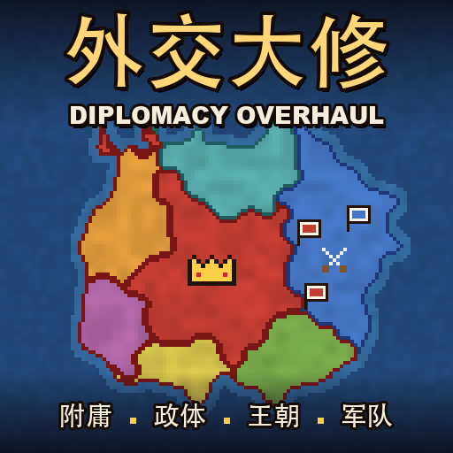
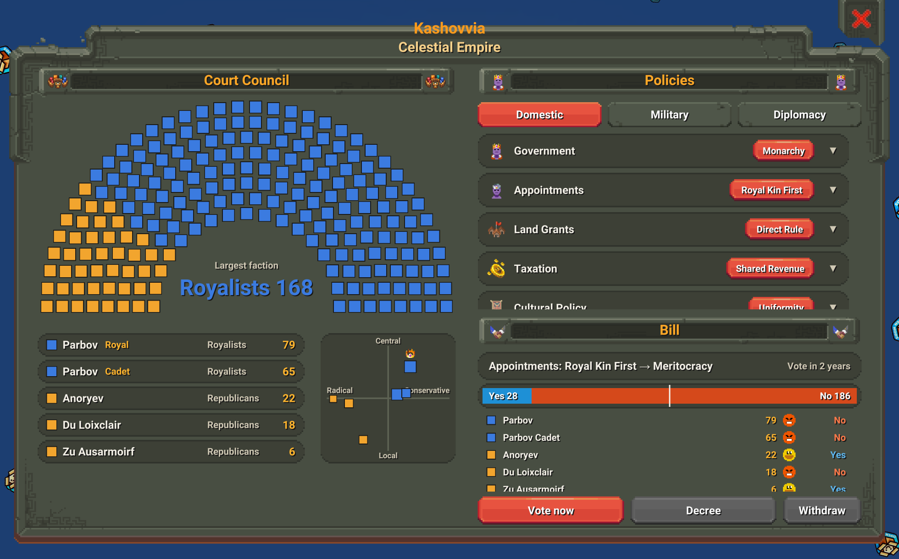
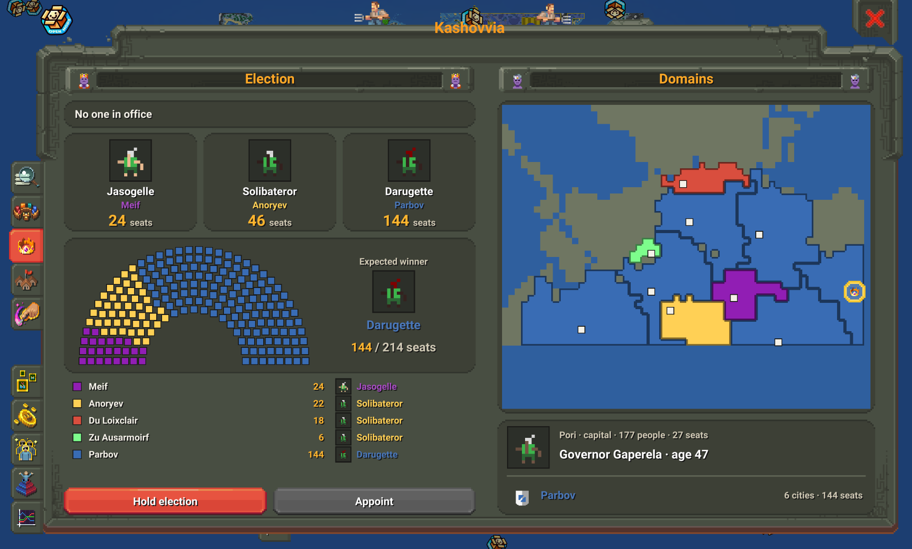
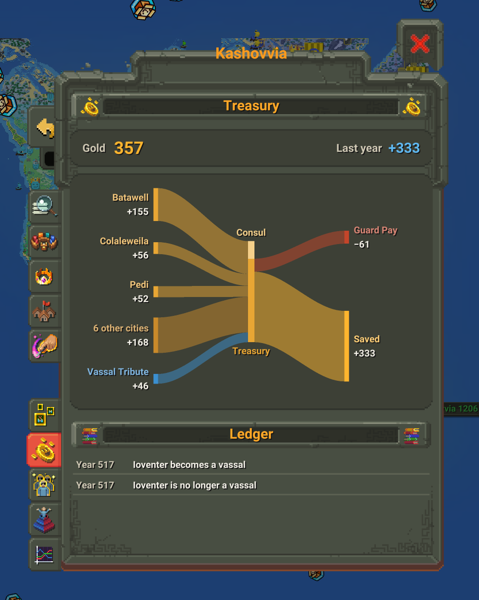

# 外交大修 Diplomacy Overhaul

[English](README.md) | 中文

**外交大修（Diplomacy Overhaul）** 为 WorldBox 加入了会自行运转的政治、附庸与战争机制。

一个不断扩张的王国，可能将边疆分封给宗室，迫使邻国称臣；国内的家族会参与议会、决定政策，王朝也会随着战争和人心走向兴盛或衰落。共和国可能演变为帝国，强盛一时的王国也可能在叛乱中四分五裂。

你可以看着这些变化自然发生，也可以亲自介入。

- Steam 创意工坊：https://steamcommunity.com/sharedfiles/filedetails/?id=3817246294
- 依赖：[NeoModLoader](https://github.com/WorldBoxOpenMods/ModLoader)
- 玩家指南：[各章节一览](#玩家指南)

## 不再只是吞并与分裂

大国不必事事亲自统治。它们会将难以管理的新领土、平叛后的城市分封出去，建立附庸，也会派遣使者要求弱小的邻国称臣。宗主与附庸在战争中同进同退，共同扩张或抵御敌人；附庸境内起了叛乱，宗主也会出兵相助。

附庸关系也会随时间变化。归附已久的附庸可能逐渐融入宗主国，成为行省，最终被收归直辖；王室成员的封国可能成为世袭行省。而不愿继续臣服的附庸，则可能密谋独立。

## 王国有了自己的政治

每个国家都有议会。各个家族根据掌握的城市获得议席，按照自己的立场投票，决定国家的内政、军事和外交政策。不同的政策组合会形成不同的**政制**，也就是国家实际实行的统治制度，议会的名称也会随之变化。

国家可以是王国、帝国，也可以是共和国、商人共和国或军事共和国。新生国家的政体受到文化倾向影响，而已有国家的制度也并非一成不变。

共和国会定期选举执政；王室绝嗣时，君主国可能改为共和国而不再分裂；鼎盛的共和国可能被野心勃勃的执政改造成帝国，崩溃中的王朝也可能被将领夺权。

你可以在议会中查看政策投票，在选举与任命窗口中了解候选人、王位继承顺序和家族封地，也可以在氏族编辑器里直接修改家族的政治立场。

## 王朝的兴衰

强大的国家也有盛衰周期。

大国拥有**天命**，它反映城市人心、君主、附庸关系与战争形势，并影响军队的战斗力。统治稳固时，国家逐渐走向鼎盛；随着积弊加深，城市开始动荡，附庸逐渐离心，王朝也会步入衰落。

当首都沦陷或天命耗尽时，一场大叛乱可能席卷全国：多座城市同时起事，附庸纷纷独立。即使叛乱最终平定，积累已久的问题也不会立刻消失。

但衰落并不意味着终结。一位有能力的君主，也可能密谋中兴，试图挽回王朝的命运。

## 战争、国库与军队

战争会按战果收场。交战双方打到一定程度就会议和，以和平、赔款、割让附庸或称臣等方式结束战争。攻城部队也会主动清剿守军，在兵力悬殊时直接破城。

国家的军事力量有了自己的财政基础。城主上缴的钱进入国库，各城市则用自己的资金维持地方军队。都城和各地上调的士兵会组成**中央禁军**，由国库供养、国家统一指挥，地方军则负责驻守边境。

战争需要钱。军队欠饷会削弱战斗力，长期无力供养时还可能被裁撤。你可以在王国的国库账簿中查看资金的来源与去向。

## 你也可以亲自介入

除了旁观国家自行发展，你还可以框选军队，通过右键命令它们进攻敌国城市、驻守己方或友方城市，以及在城外扎营。跨海行动时，军队会自动调配船只。

模组还提供一组新的神力：把一个国家册封为另一国的附庸，把一座城分封出去，煽动附庸独立，推进王朝的兴衰，或者亲手引发一场大叛乱；也可以让一个国家倾全国之兵进攻某座城，或者移交城市、吞并王国。

## 使用与兼容

所有功能都可以通过游戏底部的 **「外交大修」** 标签页访问。各个模块支持单独开启或关闭，相关数值也可以在设置中调整。

- **已有存档**：模组数据保存在原版存档中，可以直接用于已有世界。
- **手机版**：支持 NeoModLoader 可运行的移动平台。
- **性能优化**：减少原版的重复计算，大地图上帧率可提高约 20%，不改变原版的计算结果。
- **错误保护**：补丁出现异常时会自动隔离并按模块熔断，避免错误拖垮游戏。

## 玩家指南

每个系统怎么玩、关键数值是多少，见[玩家指南](docs/zh/README.md)，也可以直接跳到对应章节：

| 指南 | 内容 |
|---|---|
| [政体与领袖](docs/zh/government.md) | 君主制和共和国、各种称号、执政选举、改制、称帝、夺权 |
| [议会与政策](docs/zh/parliament.md) | 家族怎么分议席、四个派系、每项政策的效果、怎么提案和表决 |
| [王朝兴衰](docs/zh/cycle.md) | 天命、新生到崩溃的四个阶段、中兴、大叛乱 |
| [附庸](docs/zh/vassals.md) | 附庸从哪来、整合度和行省、附庸为什么会独立 |
| [战争与和谈](docs/zh/war.md) | 国家什么时候开战、战果、和约、攻城 |
| [指挥军队](docs/zh/commands.md) | 玩家怎么给军队下令：进攻、驻扎、扎营 |
| [禁军与地方军](docs/zh/armies.md) | 国家怎么调度军队、禁军和地方军的分工、军械 |
| [国库与军饷](docs/zh/treasury.md) | 钱从哪来、到哪去、欠饷会怎样 |
| [密谋](docs/zh/plots.md) | 模组新增的密谋和国王什么时候会发起 |
| [神力与设置](docs/zh/powers.md) | Tab 里的每个神力和设置开关 |
| [常见问题](docs/zh/faq.md) | 「为什么会这样」 |

## 手动安装

不用创意工坊时，可以手动安装：

1. 先安装 [NeoModLoader](https://github.com/WorldBoxOpenMods/ModLoader)
2. 从 [Releases](https://github.com/Lapis0x0/worldbox-diplomacy-overhaul/releases) 下载最新的 `DiplomacyOverhaul-v*.zip`
3. 解压到游戏目录下的 `Mods` 文件夹，解压后应该是 `Mods/DiplomacyOverhaul/mod.json`。Steam 版的游戏目录可以在库里右键 WorldBox →「管理」→「浏览本地文件」找到
4. 启动游戏，NML 会自动编译加载

更新时删掉旧的 `DiplomacyOverhaul` 文件夹再解压新的。已经在创意工坊订阅的不要再手动安装，两份会冲突。

## 参与开发

完整规则、实现和本地开发流程见[开发文档](docs/dev/README.md)。

## 许可证

MIT，见 [LICENSE](LICENSE)。
